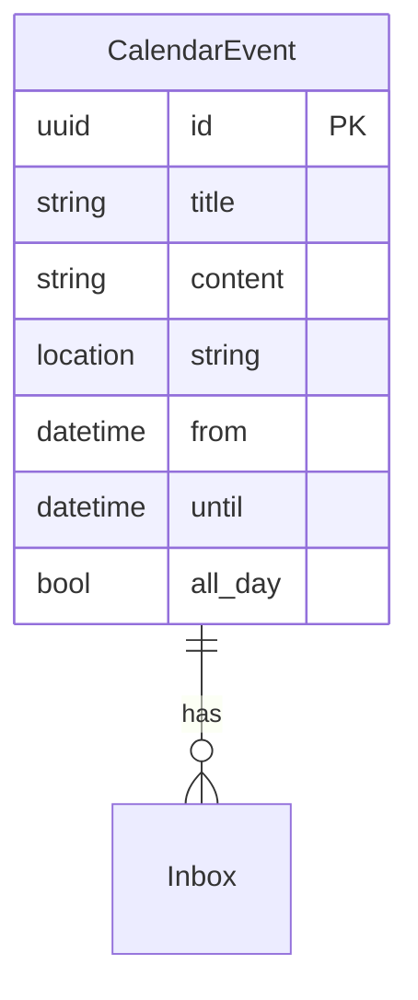

# BloomERP calendar

The BloomERP calendar will be a unified calendar.


## Core requirements

- As a user, I need to be able to see the calendars for other users I have access to.
- I need to be able to add objects to a calendar
- I need to be able to easily import items from an email attachment into a calendar
- There needs to be a button on the inbox to show the calendar
- I need to be able to easily send calendar invites to foreign email addresses, as well as internal users
- 


## ERD





## Code

```python
class CalendarEvent:
    ...

    def to_invite(self):
        """To ICS/ICALL, ..."""
        pass

```


