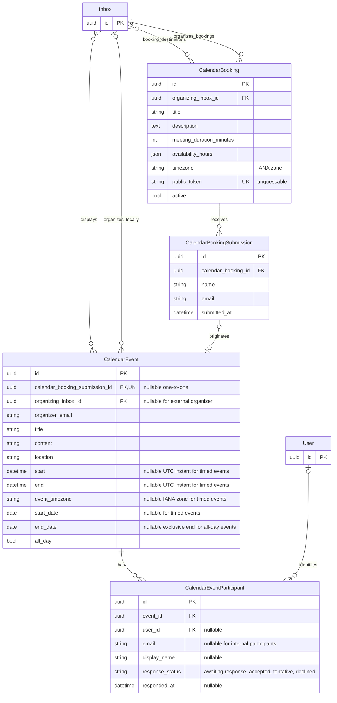
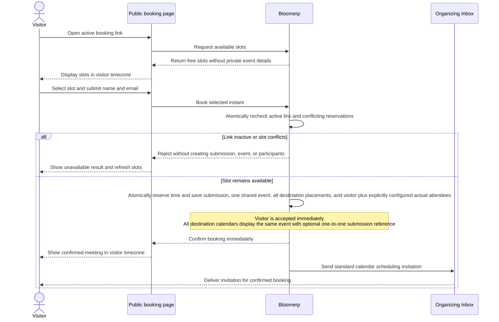
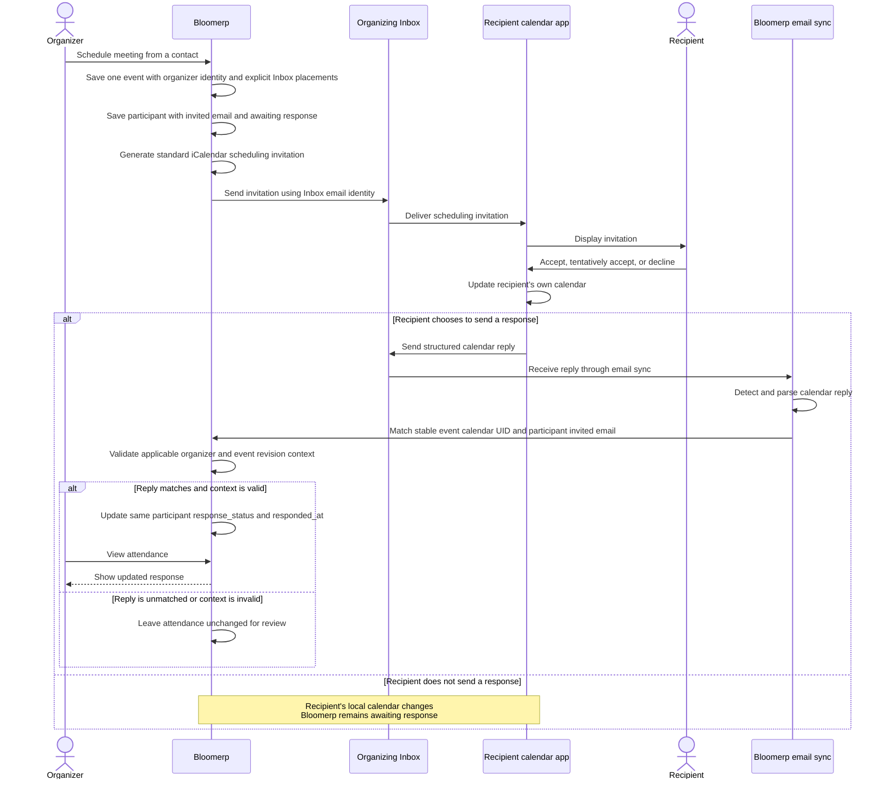
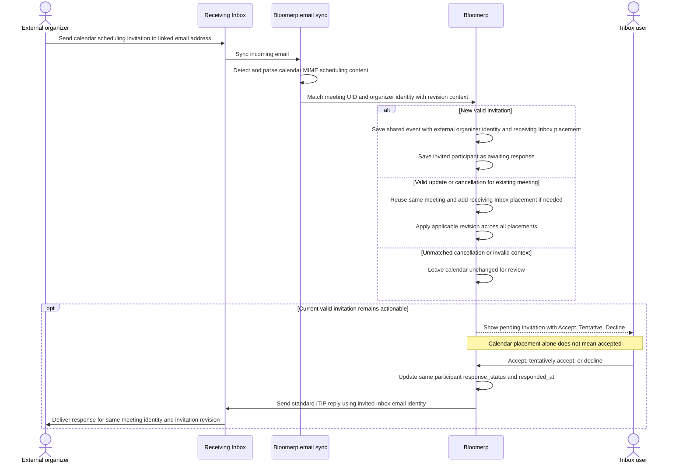

# BloomERP calendar

The BloomERP calendar will be a unified calendar.


## Core requirements

- As a user, I need to be able to see the calendars for other users I have access to.
- I need to be able to add objects to a calendar
- I need to be able to easily import items from an email attachment into a calendar
- There needs to be a button on the inbox to show the calendar
- I need to be able to easily send calendar invites to foreign email addresses, as well as internal users
- I need to be able to create a calendar link for external people to schedule meetings, like calendly

## Proposed ERD

The Inbox is the local calendar owning unit; a calendar is a view of events, with
no separate Calendar model. CalendarEvent and Inbox have an explicit many-to-many
relationship for placement: one shared event can appear in several Inbox calendars,
and each Inbox can display many events. Placement is WHERE an event appears,
participants are WHO attends with independent responses, and organizer identity
is WHO manages scheduling invitations. These are separate relationships.



- Event placement uses the explicit Inbox many-to-many relation, not a single
  placement foreign key. Adding or moving a placement changes that relation
  without duplicating the event or changing its participants or organizer.
- Locally organized events have one `organizing_inbox_id`, and `organizer_email`
  records its sending identity. Externally organized events have a null
  `organizing_inbox_id` and the external organizer email. An Inbox placement does
  not make that Inbox an organizer or grant authority over an external meeting.
- Placing an event in a shared team Inbox does not make every user with access
  an attendee. Participants and their response statuses are recorded explicitly.
- Each participant belongs to exactly one event. Internal participant identity is
  a User, not an Inbox; the user link is optional for external participants.
- External participants require an email address. Internal participants require a
  user link and may also record the email address used for the invitation.
  A participant must therefore have at least a user link or an email address.
- An internal participant relation records attendance. Calendar placement comes
  from the explicit Inbox many-to-many relation, not from participant relations
  alone. Attendees share one event rather than receiving duplicate events.
- A participant can respond in the app or by calendar email. Both channels update
  the same participant's response status and response timestamp without creating
  another attendee. `responded_at` is nullable until a response is received.
- The referencing framework attaches contacts and other business objects as
  context, separately from participant identity.
- Event access can be separate from email access. Visibility based on user access
  is under consideration; the exact authorization policy remains unresolved.


### Placement examples

- An internal meeting has explicit user participants and the same event placed
  in the attendees' Inbox calendars.
- A customer meeting can appear in both the salesperson's Inbox and the shared
  sales Inbox. Shared sales Inbox access alone does not make colleagues attendees.
- Adding or moving an event to another Inbox changes placement only. A change to
  the shared meeting's time updates the same event in every destination calendar,
  subject to the organizer's scheduling authority.

## Timezones

- Timed events require timezone-aware `start` and `end` instants normalized to UTC,
  with `end` after `start`, plus an IANA `event_timezone` such as
  `Europe/Brussels`. Their date-only fields are null. Viewers see instants converted
  to their own timezone.
- All-day events require `start_date` and an exclusive `end_date` after it.
  `start`, `end`, and `event_timezone` are null. Display these as calendar dates,
  not midnight UTC instants that shift dates when converted for other viewers.
- Booking availability hours are interpreted in the CalendarBooking's IANA timezone,
  including daylight saving changes. Do not offer nonexistent local times. When
  a local time is ambiguous, require an explicit occurrence or UTC offset before
  scheduling rather than silently guessing.
- Imported calendar data should preserve source timezone semantics and definitions
  where feasible. A source TZID may be custom rather than IANA. Resolve it using
  its supplied definition or a verified mapping before normalizing timed instants
  and selecting an IANA event timezone. If it cannot be resolved, retain the source
  for review instead of guessing a timezone. Preserve date-only imports as all-day
  date ranges.

## Calendar booking

- A CalendarBooking provides a public shareable booking page with many-to-many
  target Inboxes as destinations. These are all placement
  destinations, not a round-robin pool from which one salesperson is chosen.
  A separate organizing Inbox defines the sending identity. Its duration,
  availability hours, timezone, title, description, public unguessable token,
  and active flag define the reusable configuration.
  An active booking must have destination Inboxes and an organizing Inbox.
  CalendarBookingSubmission records booking origin and visitor details, provides
  a place for future booking-form answers, and belongs to
  CalendarBooking. CalendarEvent optionally references its originating submission
  through the nullable unique `calendar_booking_submission_id` foreign key
  (one-to-one). Each event has zero or one submission, and each submission has at
  most one event. Ordinary events leave the reference null, and submissions have
  no foreign key to events. A successful MVP booking creates exactly one shared
  event atomically with its submission, placements, and participants. No separate
  Calendar model is needed. The event remains the source of truth for the selected
  meeting time.
- The public page exposes free slots, not private event details. Calculate slots
  from configured availability and the busy calendars selected to constrain booking,
  and display them in the visitor's own timezone. An inactive link cannot accept bookings.
- The visitor selects a slot and supplies their name and email. Submission
  atomically rechecks link activity and availability while reserving the time, so
  concurrent conflicting bookings cannot both succeed. A conflict asks the visitor
  to choose another available slot without creating a successful submission, event,
  or participants.
- A successful MVP booking creates ONE shared CalendarEvent and places it in all
  configured destination Inboxes, using the separately specified organizing Inbox.
  Save the event, all destination placements, the visitor participant, any explicitly
  configured actual attendees, and CalendarBookingSubmission together in the same
  atomic confirmation. The
  submission records name, email, and `submitted_at` and references CalendarBooking.
  Set the new event's `calendar_booking_submission_id` to that submission in the
  same atomic operation, without a direct configuration foreign key on the event.
  One meeting has one shared event record across internal attendees, with
  participant records rather than clones per Inbox or submission. Booking confirms
  the visitor's participation: their status is accepted with `responded_at` set to
  the booking confirmation time. Their supplied name is recorded as their participant
  display name. Other attendees retain independent response statuses.
- Selecting actual attending users and whose busy calendars constrain slots remain
  unresolved. Do not infer attendees or busy-calendar selection from destination
  Inbox sharing, ownership, or access. The organizing Inbox supplies scheduling
  identity, not an implicit singular host.
- Confirm the booking immediately and send a standard calendar scheduling invitation
  through the organizing Inbox. The visitor remains accepted without responding to that
  email. The MVP requires no approval step and includes no payments or round-robin
  routing.

### Booking sequence



- For the booking link, use a view detail view

## Sequence

### Outgoing invitation

Proposed external invitation and response flow through the organizing Inbox:



- This is a scheduling invitation, not merely an ordinary ICS attachment;
  exporting ICS alone does not guarantee native response controls in the recipient's app.
- Processing incoming replies through email sync is required in addition to
  exporting and sending the invitation.
- Unmatched replies must not silently update another event's attendance. Repeated
  processing of the same reply must not create duplicate participants or events.

### Incoming invitation

An external organizer can invite an email address linked to a Bloomerp Inbox.
Email sync automatically adds the receiving Inbox as a placement of the pending
shared event, without requiring a manual ICS import or replacing other placements.



- Detect scheduling content from calendar MIME parts and scheduling metadata,
  rather than relying only on attachment file names. Ordinary calendar file
  imports remain a fallback.
- Repeated email sync must reuse the same event and invited participant, without
  duplicates. Match updates and cancellations against the existing meeting UID
  and organizer identity, validate their context, and apply the relevant revision
  rather than creating copies. Stale or repeated messages must not roll back newer
  meeting state.
- The receiving email identifies the invited participant. A User link may
  be recorded when known, but the Inbox itself is not a User. No user
  default-Inbox routing policy is defined by this proposal.
- A local organizer changes the time by sending a scheduling update with the same
  meeting identity and a newer revision. Updates from an external organizer sync
  into the existing event. An attendee editing their local calendar placement
  cannot reschedule the meeting for everyone.

## Code

```python
class CalendarEvent:
    ...

    def to_invite(self):
        """To ICS/ICALL, ..."""
        pass

```


