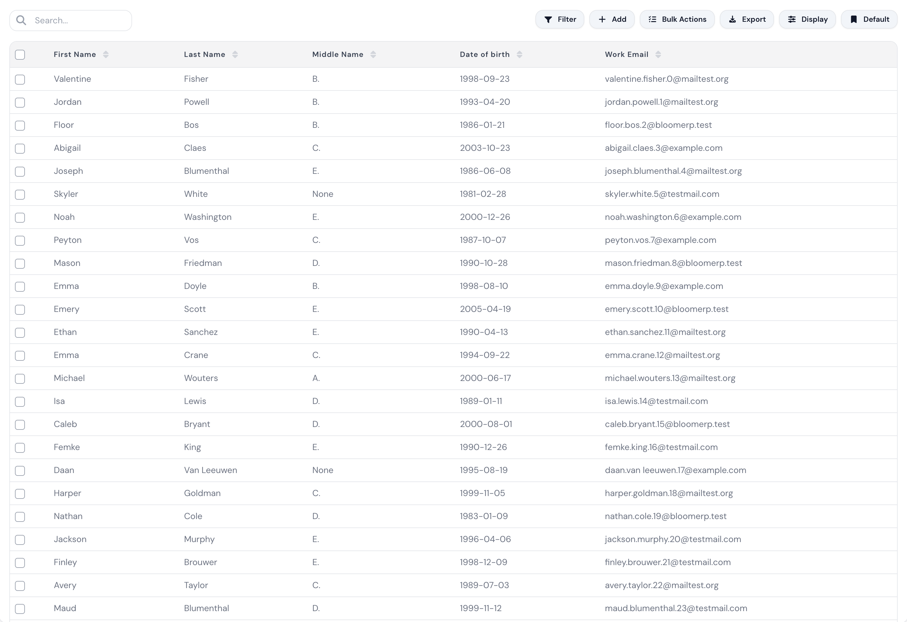
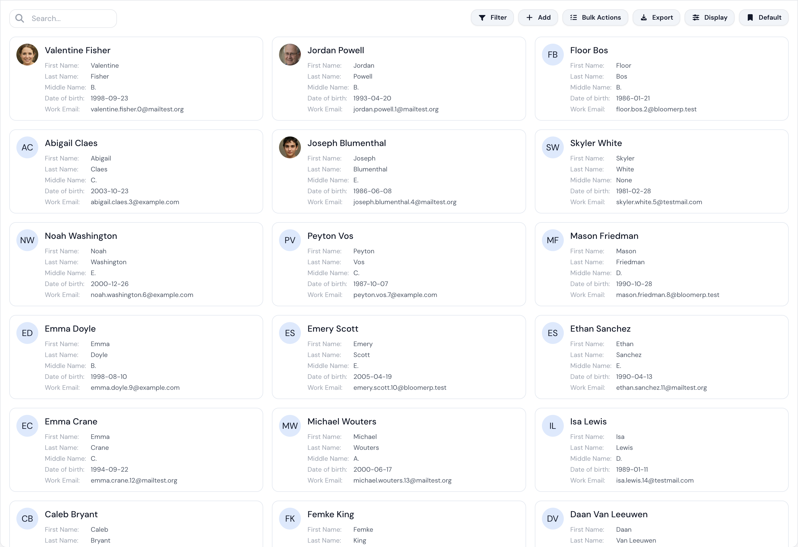
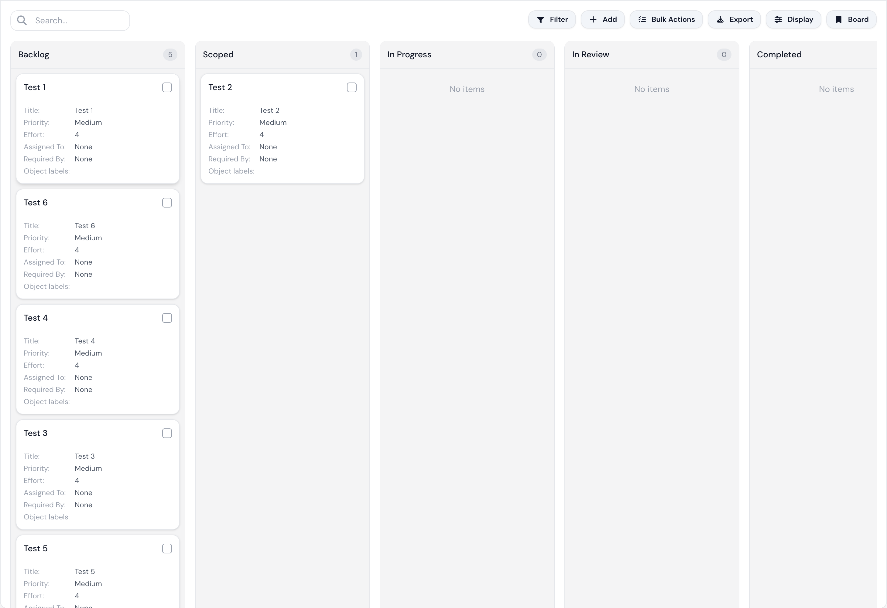
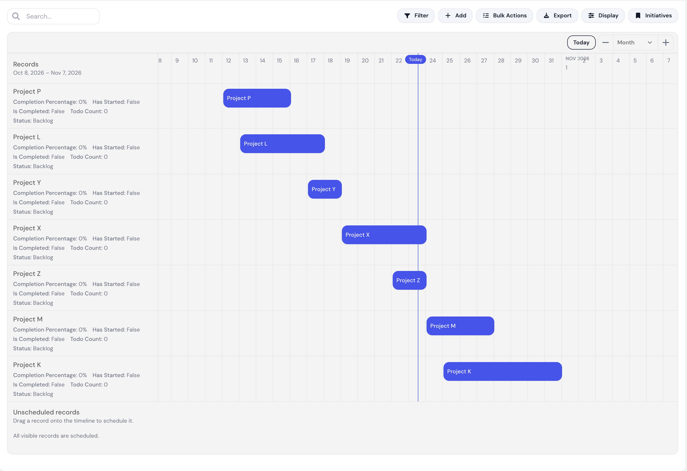

# Built-in dataviews

BloomERP already has a lot of built-in dataviews that serve most of the day-to-day use cases.

(TODO: give a warm introduction)
(TODO: for every dataview, list the available config parameters, and what they mean, in a table form)
(TODO: give an introduction into what every dataview shows, and what it could be used for)

## Table

A table is just a list

## Card

## Kanban

## Calendar

## Gant

## Files

